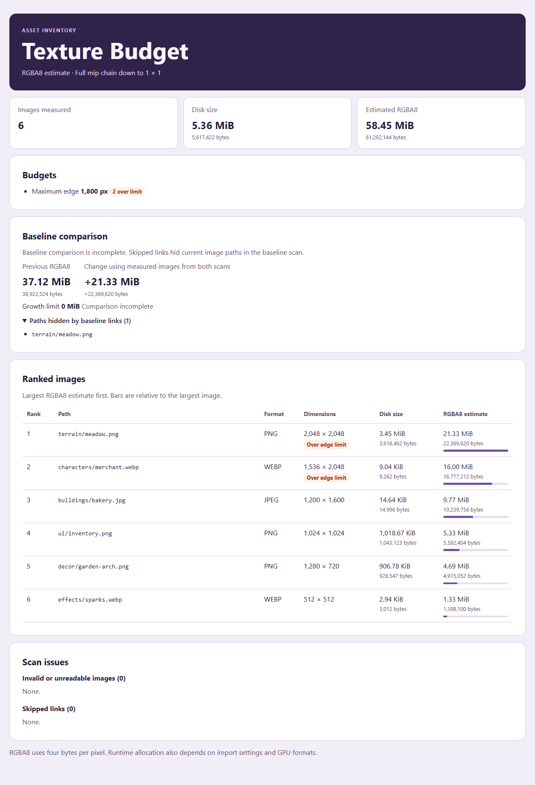

# Texture Budget

[](https://github.com/orangepony4/texture-budget/actions/workflows/test.yml)

Check texture dimensions and estimate uncompressed RGBA8 memory before importing art into a game. Texture Budget scans PNG, JPEG, and WebP headers in a folder and ranks the largest textures. It runs locally without installing any package dependencies.

## Quick start

Install Node.js 20 or newer, then clone or download the repository.

```sh
git clone https://github.com/orangepony4/texture-budget.git
cd texture-budget
node bin/texture-budget.mjs "/path/to/assets"
```

To use the `texture-budget` command from any directory, install a `.tgz` package from the [releases page](https://github.com/orangepony4/texture-budget/releases/latest).

```sh
npm install --global ./texture-budget-0.4.0.tgz
texture-budget --help
```

Use limits to check a game asset folder in CI. This example sets a 2,048-pixel edge limit, a 24 MiB per-texture budget, and a 128 MiB total budget, including mipmaps.

```sh
node bin/texture-budget.mjs assets --max-edge 2048 --max-image-mib 24 --max-total-mib 128 --mipmaps
```

Add `--json` for the complete list, totals, limit violations, unreadable headers, and skipped links. Byte counts are decimal strings so scripts can preserve exact values. Limits allow the boundary value. A texture measuring exactly 2,048 pixels on its longest edge passes a limit of 2,048.

`--max-image-mib` limits each estimated texture separately. If enabled, the JSON report includes `limits.maxImageMiB` and a list of paths in `exceeded.images`.

Use `--html` to save a report you can open in a browser or share with a teammate. The report contains paths and dimensions, uses no external resources, and keeps the same exit codes as the text and JSON formats.

```sh
node bin/texture-budget.mjs assets --mipmaps --html > texture-report.html
```



| Exit code | Meaning |
| --- | --- |
| `0` | Scan completed and the inspected images are within any supplied limits. |
| `1` | At least one limit was exceeded or an image header could not be inspected. |
| `2` | The command or the folder could not be processed. |

## Track budget growth

Save a JSON report from a known-good folder and use it as a baseline when checking a later version of the same asset folder.

```sh
node bin/texture-budget.mjs assets --mipmaps --json > texture-baseline.json
node bin/texture-budget.mjs assets --mipmaps --baseline texture-baseline.json --max-growth-mib 8
```

In Windows PowerShell 5.1, write the baseline with `node bin/texture-budget.mjs assets --mipmaps --json | Set-Content -Encoding UTF8 texture-baseline.json`.

Both scans must use the same mipmap mode. The baseline must contain no invalid or unreadable images. The comparison matches exact relative paths and lists added and removed images, changes in estimated bytes, and total growth. A growth limit of `0` allows no increase. Without a growth limit, differences are reported without failing the check. Use `--json` or `--html` to save the comparison.

## Find the most expensive folders

Use `--group-depth 1` to summarize top-level folders or `--group-depth 2` to split them one level further. Root-level files appear in the `.` group. The report ranks groups by estimated RGBA8 bytes and includes disk size and image count for each group.

```sh
node bin/texture-budget.mjs assets --mipmaps --group-depth 2 --html > folder-report.html
```

## Use in GitHub Actions

Add this step after checking out your repository. It uses GitHub Actions' Node.js runtime directly.

```yaml
- uses: orangepony4/texture-budget@v0.4.0
  id: textures
  with:
    directory: assets
    mipmaps: 'true'
    max-edge: '2048'
    max-image-mib: '24'
    max-total-mib: '128'
    group-depth: '1'
```

The action uses the same exit codes as the CLI. On a completed scan, `steps.textures.outputs.report-path` points to a JSON report in the runner's temporary directory and `steps.textures.outputs.exit-code` is `0` or `1`. A following artifact step can use `if: always() && steps.textures.outputs.report-path != ''` to retain a report even when a limit fails. An execution error fails the step without a report.

## How the estimate works

- The base level uses `width × height × 4` bytes. With `--mipmaps`, each dimension is halved and rounded down at every step, with a minimum of 1 pixel, until the chain reaches 1 × 1.
- The estimate treats each image as a separate RGBA8 texture. Compression, padding, atlases, animation frames, and engine import settings can change actual runtime use. For animated WebP, the estimate covers its canvas.
- The scan looks for `.png`, `.jpg`, `.jpeg`, and `.webp` extensions and identifies the format from the header. It reads stored dimensions without decoding pixels, so it does not validate the image payload. Symbolic links and junctions are skipped.
- JPEG inspection reads frame headers within the first 16 MiB and reports an error if it reaches the header scan limit. JPEG-LS and JPEG files whose dimensions are defined later in the image stream are outside the supported scope.
- Totals include images whose headers were read successfully. Review any invalid or unreadable paths before using the totals as a budget.
- Scan a stable folder. If the scanner detects a directory change during the scan, it exits with code `2`.

## Development

Run `npm test` for the CLI integration suite. The tests generate synthetic image headers and require no external services.

Released under the [MIT License](LICENSE).
